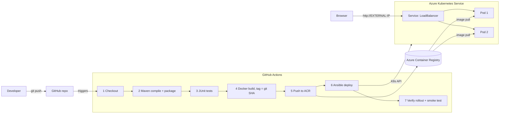

# CI/CD Demo: Java → Maven → Docker → ACR → AKS (GitHub Actions + Ansible)

Every push to `main` automatically **builds → tests → packages → containerises → publishes → deploys → verifies** a Spring Boot web app on Azure Kubernetes Service.

## Architecture



## Repository layout

| Path | What it is |
|---|---|
| `src/main/java/...` | Spring Boot app: `/` page, `/api/info`, `/api/greet`, `/actuator/health` |
| `src/test/java/...` | 7 JUnit tests (4 unit, 3 web-layer integration) |
| `pom.xml` | Maven build, produces `target/app.jar` |
| `Dockerfile`, `.dockerignore` | Runtime image, non-root, copies the already-tested JAR |
| `.github/workflows/ci-cd.yml` | The pipeline (3 jobs: build-test → docker → deploy) |
| `k8s/` | Namespace, Deployment (2 replicas, probes, rolling update), Service (LoadBalancer) |
| `ansible/` | Inventory + playbook: pull secret, apply manifests, wait for rollout, smoke test |
| `infra/` | One-time Azure setup + stop/start/destroy scripts to control cost |

## Tool choices (one line each, for the viva)

- **GitHub Actions**: no server to install or patch (Jenkins would need its own VM), free for public repos, config lives in the repo.
- **Azure (AKS + ACR)**: Azure for Students gives credit without a credit card; AKS free tier = no control-plane fee.
- **Maven**: standard Java build + dependency management; `mvn verify` compiles, tests and packages in one command.
- **Docker**: same image runs on a laptop, in CI and in the cluster: no "works on my machine".
- **Kubernetes**: self-healing (restarts crashed pods), rolling updates with zero downtime, load balancing across replicas.
- **Ansible**: declarative, idempotent deploy with built-in wait + verification; reusable from a laptop or CI.

---

## Step-by-step: what YOU need to do (about 1.5–2 hours)

### 1. Azure account (10 min)
1. Go to azure.microsoft.com/free/students, sign in with your college email. No card needed.
2. Open **portal.azure.com** → click the `>_` (Cloud Shell) icon → choose **Bash**.

### 2. Create cloud resources (15 min, mostly waiting)
In Cloud Shell, upload `infra/setup-azure.sh` (Upload button) and run:
```bash
bash setup-azure.sh
```
It prints 4 values at the end. Keep that tab open.
📸 **Screenshots:** Resource group page showing AKS + ACR; AKS → Node pools showing 1 node *Ready*.

> If the VM size or region is rejected, the error lists what is allowed — Azure for Students only permits some regions (`az policy assignment list --query "[].parameters.listOfAllowedLocations.value" -o tsv`).

### 3. GitHub repo + secrets (10 min)
1. Create a **public** repo, e.g. `cicd-demo`, and push this folder:
   ```bash
   git init && git add . && git commit -m "Initial CI/CD pipeline"
   git branch -M main
   git remote add origin https://github.com/<you>/cicd-demo.git
   ```
   **Don't push yet.**
2. Repo → **Settings → Secrets and variables → Actions → New repository secret**, add:
   `ACR_SERVER`, `ACR_USERNAME`, `ACR_PASSWORD`, `KUBE_CONFIG`
3. Repo → **Settings → Environments → New environment** → name it `production`.

### 4. First run (10 min)
```bash
git push -u origin main
```
Open the **Actions** tab and watch the 3 jobs go green.
📸 **Screenshots:** the full pipeline graph (all green); the *JUnit Tests* check showing 7 passed; the deploy job log ending with "Live at http://…"; the run *Summary* with the app URL.

If the build job fails, open its log and fix it — I wrote the code without being able to run Maven, so a first-run fix is possible (most likely a typo-level issue).

### 5. Collect evidence (10 min)
In Cloud Shell:
```bash
az aks get-credentials -g cicd-demo-rg -n cicd-demo-aks
kubectl get nodes
kubectl get deploy,pods,svc -n cicd-demo -o wide
az acr repository show-tags -n <your-acr-name> --repository cicd-demo -o table
```
📸 **Screenshots:** each command's output (pods `Running`, deployment `2/2` ready, EXTERNAL-IP); ACR → Repositories → `cicd-demo` with tags; browser at `http://<EXTERNAL-IP>`.

### 6. Change & redeploy demo (10 min) — the most important part
1. In `HomeController.java` change `v1` to `v2` (e.g. `"Welcome to the CI/CD Demo - v2 (deployed automatically)"`).
2. ```bash
   git commit -am "Change welcome message to v2" && git push
   ```
3. While it runs, in Cloud Shell: `kubectl get pods -n cicd-demo -w` — you'll see new pods start and old ones terminate (rolling update).
📸 **Screenshots:** the commit on GitHub; the new run triggered by it; ACR showing the new tag; `kubectl get pods` mid-rollout; browser showing **v2** and the new commit SHA as version.

### 7. Save money
```bash
bash cost-control.sh stop    # after each session
bash cost-control.sh start   # before the viva (IP may change → re-run pipeline or check kubectl get svc)
bash cost-control.sh destroy # after marks are out
```

---

## Running locally (optional)
```bash
mvn clean verify                       # build + tests
java -jar target/app.jar               # http://localhost:8080
docker build -t cicd-demo . && docker run -p 8080:8080 cicd-demo
```

## Troubleshooting

| Symptom | Cause / fix |
|---|---|
| Deploy job: pods stuck `ImagePullBackOff` | ACR secrets wrong → re-copy `ACR_USERNAME`/`ACR_PASSWORD` |
| Deploy job: "Unauthorized" / connection refused | `KUBE_CONFIG` copied incompletely, or cluster is stopped (`cost-control.sh start`) |
| Pods `CrashLoopBackOff` | `kubectl logs -n cicd-demo <pod>` |
| LoadBalancer IP stays `<pending>` | Wait 2–3 min; check `kubectl describe svc -n cicd-demo cicd-demo` |
| Docker job: `target/app.jar` not found | build-test job failed or artifact name changed |
